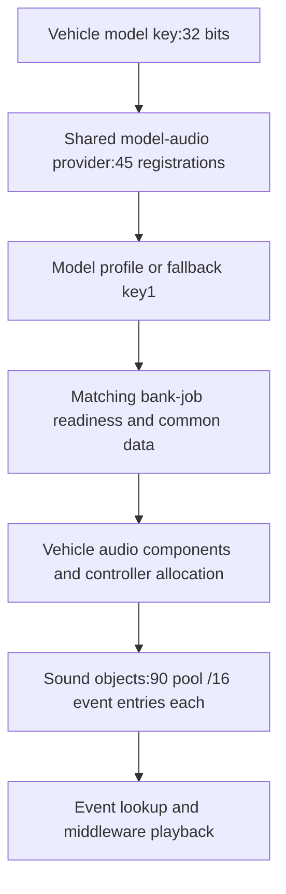

# Shared vehicle-audio limits:45 model-profile registrations

The broader static review found an actual **45-entry model-keyed vehicle-audio data registry**, upstream of sound-object creation and middleware PostEvent. Its registration function silently skips registration when its active count reaches45. This is a concrete shared constraint capable of selecting a stable subset of models, independent of free audio memory and successful bank callbacks. It is a stronger fit to the user's repeated same-working/same-silent-model observation than the playback capacities measured so far.

Runtime saturation is **not yet measured**. In particular, missing model profiles invoke fallback key1; this can succeed or fail depending on available data/bank state. The static limit does not prove which models are retained, that45 records were populated in any supplied run, or that all missing car audio is caused by this gate. No patch/build was made.

## Scope and verification

Only the previously authorized exact `E:\Games\Driver San Francisco Save Bug Test\Driver.exe` and focused existing workspace files were read. Executable SHA256 `C79987B0548F7130337C3F295C8FE269E120CEDDAD55C1159E6F5CBC6AA26616`.35 exact native spans, provider vtable slots and layout arithmetic verified with `python scripts/verify_vehicle_audio_registry_static.py`.

Evidence: `analysis/audio_vehicle_shared_static_2026-11-05/verified_model_audio_registry.json`, focused native disassembly, service vtable and bounded reference inventories. Disassembly fragments starting mid-instruction and switch-table data were not used as code evidence. No game/debugger/ASI execution, build/install, web search, other game-folder access or workspace/history/reference scan. Existing150 requests/160 graphics slots/ED+EF/indexed262144 and all staged ASIs remain unchanged.

## Shared setup chain

The vehicle sound setup routine553860 is called by multiple controller acquisition/update paths (5552E3,55653C,5566DC). Its input points at a vehicle and it reads a DWORD key from vehicle+5AC. That key is used for model-audio data and the matching type3 bank job. The model-audio role is established from this caller chain and the components consuming the returned data; stripped class names are not available.

The old probes measure selected bank operations, emitters, event admission/cleanup and middleware slot/memory gates. They do not measure the model-profile registration ceiling or the full set of setup exits. A bank can be loaded successfully while its model-specific profile is not registered or selected.

## Provider identity and exact45-entry gate

1. Static registrationD39A20 binds service IDA0 (160) to factory557000 through86A4F0. A0 is a service identifier, not a160-model capacity.
2. Shared audio initialization5453A0 obtains that service through86A4C0 and stores it at `[Engine+280]` (5453F7), also retaining the pointer in its own fields.
3. Factory557000 allocates2F0 bytes (752) and installs vtableDE3824. Its slots are registration556E30 (+4), set common data556E00 (+8), unregister556E50 (+C), model lookup556E90 (+10), get common data556E10 (+14).
4. At556E30: `83 79 0C 2D` = `CMP DWORD [ECX+0C],45`.
5. At556E34: `73 13` = `JAE556E49`.
6.556E49 is `RET8`; it returns without calling the map insertion or storing the supplied data pointer. There is no error result for the caller to test on this branch.
7. Below45,556E3E calls find/insert556F60 and556E47 stores the supplied profile pointer into its value field.

The check precedes key lookup: once full, even registration intended to update an existing key is skipped by this wrapper. Unregistration556E50 unlinks the matching node, recycles it and decrements the active count, so the limit is active registrations rather than a lifetime total. Which records remain depends on registration/unregistration order.

If the expanded preload submits more than45 different model profiles without removing earlier ones, this code retains the admitted subset and skips later registrations. A stable ordering could therefore produce the same working models repeatedly. That is a mechanism supported by code, not a claim that the supplied logs directly observed it.

### Storage matches the limit

| Field | Offset /size |
|---|---|
| Provider vtable |+00 |
| Map header:free cursor/recycled count/active count |+04/+08/+0C |
| Inline nodes |+10 through+2DF |
| Node stride |16B:links0/4, DWORD model key8, profile pointer+C |
| Sentinel |+2E0 |
| Common data pointer |+2EC, in the unused sentinel value field |
| Complete allocation |2F0B |

`(2E0-10)/16 =45`. Generic insertion7D7270 advances a fresh cursor by16 at7D72AC and increments header+8, equivalent to provider+0C, at7D72AF. The count and model keys are32-bit;45 is an explicit configured/storage boundary, not an8-bit key encoding.

**Do not increase only the comparison.** Node46 would occupy the sentinel/common-data region. A capacity change requires auditing/revising allocation, constructors, sentinel/default offsets, lookups, removal/cleanup and every method using this layout. Generic insertion7D7270 and some map helpers have many unrelated callers; they must not be globally changed to fix this provider.

## Why this can suppress all categories for selected models

At55388F, shared vehicle setup copies vehicle+5AC into controller+10. It obtains `[Engine+280]`, calls virtual+10 with that key and saves the returned model profile at controller+BC. Virtual+14 supplies common data at controller+C0.

If the model profile is null,5538DD replaces the key with1 and retries the profile lookup. It then:

- Calls48F780 with the selected key at553913. That searches the active resource list for type3/key match and requires job state4 plus nonzero bank ID. Failure branches at55391A to the false return553AD5.
- Checks the model-profile pointer at553920 and common-data pointer at55392D. Either missing pointer also returns false.
- Requires mode-specific component setup to return true at5539CB; only then proceeds with more vehicle sound initialization.

Those exits occur before the events the existing reason probe observes. Rejected/absent profile data can therefore disable a vehicle's audio setup without creating a PostEvent zero, triggering Malloc failure or filling the16-entry list.

**Fallback matters:** a missing profile alone does not always mean silence. If profile1, its matching bank job and common data exist, the vehicle may continue using fallback data. The first runtime check must record the original key, lookup result, fallback key/result and bank readiness so this distinction is resolved rather than assumed.

Model lookup556E90 follows the same registry; missing keys return null. The ordered map finder556F10 compares full DWORD keys and traverses linked nodes. Bank-job readiness48F780 also traverses to its list sentinel with a DWORD key; there is no separate first45-only traversal in those inspected lookups. Earlier game callback state4 is completion bookkeeping, not middleware success; the newer probe already separately measures actual callback results, but neither measurement validates profile registration.

## Other shared constraints identified

| Stage | Static constraint | Interpretation /measurement status |
|---|---|---|
| Model-profile registry |45 active registrations | Direct silent full branch; unmeasured in current ASIs. Best new candidate for consistent model subset. |
| Heavy vehicle sound controller allocator54A690 |5 fixed slots, stride105C8 | Scans availability; with a force flag can recycle/evict an eligible owner or slot0, otherwise can return null. Allocation/selection not probed. This is not5 registered vehicle models or5 total audible effects. |
| Scene vehicle controller acquisition5551E0 |7 fixed slots, stride2CC | Searches existing/free entries and exits when all seven occupied. Lookup/removal/update paths use the same bound. Not measured. This concerns concurrent controllers, not total resident model definitions. |
| Vehicle setup state |vehicle+5E7, profile/common pointers, matching bank-job state, mode setup | Can exit before posting. Neither the flag's full lifecycle nor these outcomes has been measured. |
| Existing downstream constraints |90 sound objects,16 events/object, global2048, per-record8/255 users, memory-pressure gate | Measured paths did not refuse in supplied paired runs; other downstream voice/stream limits remain possible. |

The5/7 controller pools may impose concurrency/priority selection rather than a permanent set of45 supported models. Increasing every number would conflate different roles and requires separate storage/lifetime audits. The45 registry directly keys data by the vehicle model identifier and therefore warrants priority for the user's stable-set symptom.

## What has and has not been established

Established statically: a shared, model-keyed45-entry provider, its exact full-return branch, physical node capacity, full-width keys, vehicle consumer, fallback1 and early setup exits. This explains how shared infrastructure can affect a repeatable subset even while banks report loaded, ambient/other-car audio works and playback pools have headroom.

Not established: live population45, rejected model IDs, the ordering of profile arrivals/unloads, successful versus failed fallback, whether the silent Escalade/Zonda/370Z are rejected, or the functions of the Crown-only event IDs. The cop-car siren remains a confound for direct event-ID comparisons, but does not affect this registry finding.

## Next bounded work

Target the registry across the whole requested roster: registration count/high-water, accepted/skipped original model IDs, unregister activity, lookup nulls and fallback/bank/setup outcomes. This is a shared-model census, not another random single-car test. Existing logs cannot reconstruct those missing counters retrospectively.

Before any expansion, finish the provider-specific layout/cleanup audit and choose complete enlarged or external node storage with all related offsets updated. A controlled capacity test should retain the model census so it can show whether previously skipped IDs become registered and whether audio setup then succeeds. No new ASI/build/install or behavior change was authorized/performed during this static research. Driver.exe was sufficient for this finding; x32dbg is not needed to identify the ceiling.
